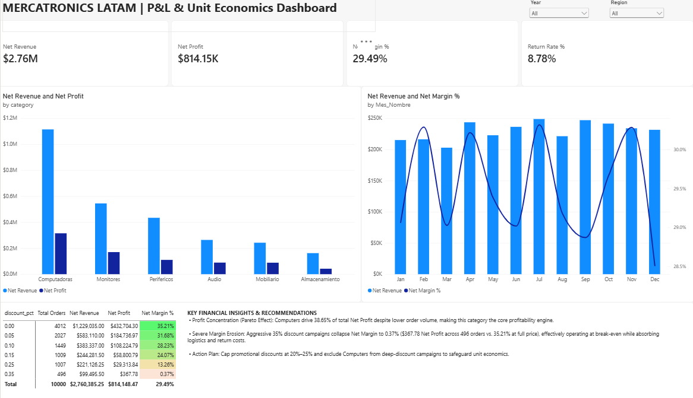

# Mercatronics LatAm — E-Commerce P&L & Unit Economics Pipeline


## Executive Summary
An end-to-end **Data Analytics & Financial Engineering** pipeline auditing **10,000 e-commerce transactions** (2024–2025) across 2,000 customers and 8 product lines. While commercial reports highlighted strong top-line sales (**$3.49M Gross Revenue**), this audit uncovers real bottom-line profitability (**$814.15K Net Profit**, **29.49% Net Margin**) after accounting for promotional discounts, Cost of Goods Sold (COGS), logistics expenses, and unrecovered return shipping losses.

---

## Interactive Power BI Dashboard


---

## Key Business Findings & Recommendations
1. **Profit Concentration (Pareto Effect):** The **Computers** category drives **38.65% of total Net Profit** despite representing a lower share of order volume, serving as the company's primary profitability engine.
2. **Severe Margin Erosion on Deep Discounts:** Orders with **35% promotional discounts** collapse Net Margin to **0.37%** (**$367.78 Net Profit** across 496 orders and $99.50K Net Revenue), compared to **35.21% Net Margin** ($432.70K Net Profit) at full price.
3. **Return Logistics Leakage:** An **8.78% Return Rate** generates direct unrecovered shipping costs, turning returned transactions into net negative unit economics.
4. **Strategic Action Plan:**
   - Cap promotional discounts at **20%–25%** across general campaigns.
   - Exclude the **Computers** category from deep-discount events to protect core margins.
   - Audit logistics partners and return triggers to reduce the 8.78% return rate.

---

## End-to-End Data Architecture

```text
[ERP Raw CSVs] ──► [Python ETL Pipeline] ──► [MySQL Server (mercatronics_db)] ──► [Power BI & Excel]
 (data/raw/)       (Pandas & NumPy P&L)      (PyMySQL + CTEs & Window Funcs)      (Star Schema + Audit)
```

### Technical Highlights by Layer
* **1. Python ETL & Financial Feature Engineering (`src/clean_finance_pipeline.py`):**
  - Cleaned missing values (`858` free-shipping nulls imputed to `$0.00`; `104` unattributed customer acquisition channels mapped to `Direct / Unknown`).
  - Merged 3 relational datasets (`orders`, `products`, `customers`) and engineered P&L metrics (`Gross Revenue`, `Discount Amount`, `Net Revenue`, `COGS`, `Net Profit`) using vectorized `np.where()` accounting rules for `Completed`, `Returned`, and `Canceled` orders.
* **2. Relational Database & Advanced SQL (`src/load_to_mysql.py`, `sql/financial_queries.sql`):**
  - Built a secure direct loader into **MySQL Server** (`pymysql`) with explicit accounting schemas (`DECIMAL(12,2)` and `PRIMARY KEY` constraints) and credentials isolated via `.gitignore`.
  - Developed analytical SQL reports in **MySQL Workbench** using **CTEs (`WITH`)**, conditional aggregation (`CASE WHEN`), and **Window Functions** (`RANK() OVER`, `SUM() OVER`) to quantify Pareto profit contribution and discount-tier erosion.
* **3. BI Modeling & DAX (`Mercatronics_PnL_Dashboard.pbix`):**
  - Implemented a 4-table **Star Schema** (`fact_orders_financials` linked `1:*` to `dim_customers`, `dim_products`, and a DAX `Calendario` table).
  - Engineered dynamic DAX KPIs (`Net Revenue`, `Net Profit`, `Net Margin %`, `AOV`, `Return Rate %`) using `CALCULATE` and `DIVIDE`.
* **4. Executive Reconciliation (`reports/Mercatronics_Financial_Audit.xlsx`):**
  - Exported SQL audit tables into Excel for financial reconciliation and automated discount-policy alerts.

---

## Repository Structure
```text
├── assets/
│   └── dashboard_preview.png         # Power BI P&L Dashboard snapshot
├── data/
│   ├── raw/                          # Raw ERP CSVs (excluded via .gitignore)
│   └── processed/                    # Cleaned Star Schema tables
├── reports/
│   └── Mercatronics_Financial_Audit.xlsx
├── sql/
│   └── financial_queries.sql         # Discount audit & Window Function rankings
├── src/
│   ├── generate_raw_data.py          # Reproducible ERP data generator (seed=101)
│   ├── clean_finance_pipeline.py     # Financial ETL & Unit Economics engine
│   └── load_to_mysql.py              # Direct MySQL DDL/DML loader (PyMySQL)
├── Mercatronics_PnL_Dashboard.pbix   # Interactive Power BI report
├── .gitignore                        # Protects raw data & DB credentials
└── README.md
```

---

## How to Reproduce Locally
1. Clone this repository and install dependencies:
   ```bash
   pip install pandas numpy pymysql cryptography
   ```
2. Generate raw ERP data and run the financial ETL pipeline:
   ```bash
   python src/generate_raw_data.py
   python src/clean_finance_pipeline.py
   ```
3. Create `mercatronics_db` in MySQL, add your local credentials to `src/db_config.py`, and run:
   ```bash
   python src/load_to_mysql.py
   ```
4. Execute `sql/financial_queries.sql` in MySQL Workbench or open `Mercatronics_PnL_Dashboard.pbix` in Power BI Desktop.